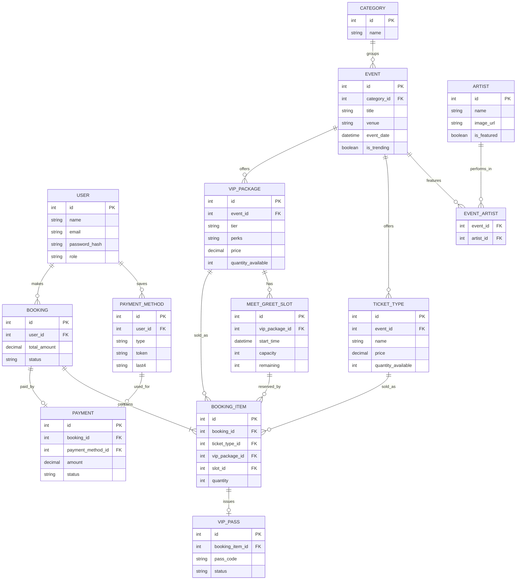

# Technical Specifications Document

## Title Page

- **Project Name**: EncoreHub
- **Version**: 1.0 (Draft)
- **Date**: November 9, 2026
- **Author(s)**:
  - Marius Alaba (Group Leader)
  - Mark Anthony Delloza
  - Mark Angelo Vicedo

---

## Table of Contents

1. [Introduction](#1-introduction)
2. [Overall Description](#2-overall-description)
3. [Visual Mockup Reference](#3-visual-mockup-reference)
4. [Features](#4-features)
5. [Functional Requirements](#5-functional-requirements)
6. [Non-Functional Requirements](#6-non-functional-requirements)
7. [Data Requirements](#7-data-requirements)
8. [External Interface Requirements](#8-external-interface-requirements)
9. [Glossary](#9-glossary)
10. [Appendices](#10-appendices)

---

## 1. Introduction

### Purpose

EncoreHub is an event booking website where fans can discover concerts and live events, book tickets, and purchase **VIP packages** that include exclusive experiences such as meet-and-greets with artists. The client wants the platform to stand out by rethinking how VIP packages are offered: a better customer experience, higher perceived value for VIP buyers, and something more competitive than existing ticketing sites.

This document describes what EncoreHub must do, in language the client and the development team can both understand. It is the foundation for the back-end and front-end phases of the project.

### Scope

**EncoreHub will:**

- Show upcoming, trending, and featured events and artists on the homepage.
- Let visitors browse events by category and search for events.
- Give every event its own page with complete details and images.
- Let customers register, log in, and manage their profile (personal information, email address, and payment details).
- Let customers book tickets for an event.
- Provide a dedicated **VIP Experiences** page where customers compare VIP packages, book a meet-and-greet slot, and receive a digital VIP pass.
- Work on mobile, tablet, laptop, desktop, and widescreen displays.

**EncoreHub will not (in this version):**

- Offer a native mobile app (the website is mobile-responsive instead).
- Process real payments. Payment is simulated in the MVP and designed so a real payment provider can be added later.
- Resell or transfer tickets between users.
- Provide an interactive seat map, add-on purchases, or an automated VIP waitlist. These are listed as future enhancements in the Appendices.

### Definitions, Acronyms, and Abbreviations

See [Glossary](#9-glossary).

### References

- Ticketworld (ticketworld.net) and Araneta Coliseum: reference applications for homepage highlights, categories, search, event pages, and profile pages.
- Ticketmaster and Live Nation: reference applications for the VIP guide. Used for inspiration only, not copied.
- Zuitt side project briefing (B640 meeting, October 27, 2026) and the Technical Specification template provided by the instructor.

---

## 2. Overall Description

### Product Perspective

EncoreHub is a standalone web application with three parts: a front end that customers see in their browser, a back end (server and API) that handles the business rules, and a database that stores users, events, packages, and bookings. It is inspired by existing ticketing sites but adds a purpose-built VIP experience.

### Product Functions

At a high level, EncoreHub lets users:

1. Discover events through highlights, categories, and search.
2. View full event details.
3. Create an account and manage a profile.
4. Book event tickets.
5. Compare VIP packages and book a VIP package with a meet-and-greet time slot.
6. Receive and view a digital VIP pass (QR code) after booking.
7. Let administrators manage events, artists, ticket types, VIP packages, and meet-and-greet slots.

### User Classes and Characteristics

| User Class | Description | Typical Needs |
|---|---|---|
| **Guest** | A visitor who has not logged in. | Browse and search events, view event pages and the VIP page. Cannot book. |
| **Registered Customer** | A logged-in user. | Book tickets, manage profile and payment details, view booking history. |
| **VIP Customer** | A registered customer who has booked a VIP package. | View VIP pass, see meet-and-greet slot details. |
| **Administrator** | Staff who run the platform. | Create and edit events, artists, ticket types, VIP packages, and slots; view bookings. |

All customer-facing users are assumed to be non-technical. The interface must be self-explanatory.

### Operating Environment

- **Client side:** Current versions of Chrome, Firefox, Edge, and Safari on mobile and desktop devices.
- **Server side:** A web server hosting the back-end API and a database. The final technology stack will be confirmed by the team and recorded in the Appendices.
- **Network:** Requires an internet connection.

### Assumptions and Dependencies

- Event, artist, and package data is entered by administrators. No live integration with real ticketing systems.
- Payments are simulated for the MVP.
- A QR code library is available to generate VIP passes.
- An email service (or a simulated one) is available for booking confirmations.
- The project must be completed in phases: documentation, back end, then front end, of roughly two weeks each.
- The GitHub repository, Trello board, and Figma and ERD files are publicly viewable, as required by the course.

---

## 3. Visual Mockup Reference

- **Figma Prototype**: _[Insert public Figma link here]_
- **Exports (PNG)**: _[Insert link or embed screenshots here]_

**Required pages (minimum of five, each in mobile and desktop versions):**

| # | Page | Purpose |
|---|---|---|
| 1 | Home | Trending events, featured artists, search bar, category shortcuts |
| 2 | Browse / Search Results | Category filters and search results |
| 3 | Event Details | Event image, description, date, venue, ticket types, "Book" button |
| 4 | VIP Experiences | Package tiers, comparison view, meet-and-greet slots |
| 5 | Booking / Checkout | Ticket or package summary, payment, confirmation |
| 6 | Profile | Personal info, email, payment details, bookings, VIP passes |
| 7 | Login / Register | Account access |

**Responsive breakpoints to design for:** mobile, tablet, laptop, desktop, and widescreen.

**Style guide (to be finalized in Figma):**

- **Typography guide**: _[Heading font, body font, sizes]_
- **Color scheme**: _[Primary, secondary, accent (a gold accent is suggested for VIP elements), background, text]_

---

## 4. Features

| ID | Feature | Description |
|---|---|---|
| F-01 | Homepage Highlights | Shows upcoming and trending events and featured artists, similar to a "Top 10" display, so customers see what is happening right away. |
| F-02 | Event Categories and Search | Events are organized into categories (such as concerts, theater, comedy, sports) and a search bar helps customers find events quickly. |
| F-03 | Event Details Page | Each event has its own page with images and complete information so customers know exactly what they are booking. |
| F-04 | User Accounts and Profile | Customers register, log in, and manage personal information, email address, and payment details. |
| F-05 | Ticket Booking | Customers choose a ticket type (General Admission, Lower Box, Upper Box) and quantity, then confirm the booking. |
| F-06 | Tiered VIP Packages | Each event can offer Silver, Gold, and Platinum VIP packages with different perks and prices. |
| F-07 | VIP Package Comparison | Customers compare VIP tiers side by side on the VIP Experiences page. |
| F-08 | Meet-and-Greet Slot Booking | Customers pick a time slot for their meet-and-greet. Each slot has limited capacity. |
| F-09 | Digital VIP Pass | After booking, a QR-code pass appears on the customer's profile for entry and perks. |
| F-10 | Admin Management | Administrators manage events, artists, ticket types, VIP packages, slots, and view bookings. |

---

## 5. Functional Requirements

### Use Cases

#### UC-01: Browse Events

- **Title**: Browse Events
- **Description**: A user views highlighted and categorized events.
- **Actors**: Guest, Registered Customer
- **Preconditions**: The website is available.
- **Postconditions**: The user sees a list of events.
- **Main Flow**:
  1. The user opens the homepage.
  2. The system shows trending events and featured artists.
  3. The user selects a category.
  4. The system shows events in that category.
- **Alternate Flows**: If a category has no events, the system shows a "No events yet" message with a link back to the homepage.

#### UC-02: Search for an Event

- **Title**: Search for an Event
- **Description**: A user finds events by keyword.
- **Actors**: Guest, Registered Customer
- **Preconditions**: At least one event exists.
- **Postconditions**: Matching events are displayed.
- **Main Flow**:
  1. The user types into the search bar.
  2. The system searches event names, artists, and categories.
  3. The system shows the matching results.
- **Alternate Flows**: If nothing matches, the system shows "No results found" and suggests popular events.

#### UC-03: View Event Details

- **Title**: View Event Details
- **Description**: A user opens a single event page.
- **Actors**: Guest, Registered Customer
- **Preconditions**: The event exists and is published.
- **Postconditions**: The full event details are displayed.
- **Main Flow**:
  1. The user selects an event.
  2. The system shows the event image, description, date, time, venue, ticket types with prices and availability, and any VIP packages.
- **Alternate Flows**: If the event has been removed or has passed, the system shows an "Event unavailable" message.

#### UC-04: Register and Log In

- **Title**: Register and Log In
- **Description**: A user creates an account and logs in.
- **Actors**: Guest
- **Preconditions**: The user is not logged in.
- **Postconditions**: The user is logged in as a Registered Customer.
- **Main Flow**:
  1. The user opens Register and enters name, email, and password.
  2. The system validates the details and creates the account.
  3. The user logs in with email and password.
  4. The system confirms the login and opens a session.
- **Alternate Flows**: If the email already exists, or the password is wrong, the system shows a clear message and lets the user try again.

#### UC-05: Manage Profile

- **Title**: Manage Profile
- **Description**: A customer updates personal information, email address, and payment details.
- **Actors**: Registered Customer
- **Preconditions**: The user is logged in.
- **Postconditions**: The profile is updated.
- **Main Flow**:
  1. The user opens the Profile page.
  2. The user edits their details or adds or removes a payment method.
  3. The system validates and saves the changes.
- **Alternate Flows**: If validation fails, the system highlights the incorrect fields and does not save.

#### UC-06: Book Event Tickets

- **Title**: Book Event Tickets
- **Description**: A customer books tickets for an event.
- **Actors**: Registered Customer
- **Preconditions**: The user is logged in and tickets are available.
- **Postconditions**: A booking is created, availability is reduced, and a confirmation is shown.
- **Main Flow**:
  1. The user selects ticket type and quantity on the event page.
  2. The system shows an order summary.
  3. The user confirms and pays using a saved or new payment method.
  4. The system creates the booking and shows a confirmation.
- **Alternate Flows**: If tickets sell out while the user is checking out, the system cancels the order and tells the user. If payment fails, no booking is created.

#### UC-07: Compare VIP Packages

- **Title**: Compare VIP Packages
- **Description**: A user compares Silver, Gold, and Platinum packages for an event.
- **Actors**: Guest, Registered Customer
- **Preconditions**: The event has VIP packages.
- **Postconditions**: The user sees the packages side by side.
- **Main Flow**:
  1. The user opens the VIP Experiences page and selects an event.
  2. The system shows each package's perks, price, and availability in a comparison view.
- **Alternate Flows**: If an event has no VIP packages, the system explains that none are offered yet.

#### UC-08: Book a VIP Package with a Meet-and-Greet Slot

- **Title**: Book a VIP Package
- **Description**: A customer buys a VIP package and reserves a meet-and-greet time slot.
- **Actors**: Registered Customer
- **Preconditions**: The user is logged in. The package and at least one slot are available.
- **Postconditions**: The booking is created, the slot capacity is reduced, and a VIP pass is generated.
- **Main Flow**:
  1. The user selects a package.
  2. The system lists available meet-and-greet slots.
  3. The user picks a slot.
  4. The user reviews the summary and pays.
  5. The system creates the booking, reserves the slot, and generates the VIP pass.
- **Alternate Flows**: If the slot fills up before payment completes, the system asks the user to choose another slot. If the user is not logged in, the system sends them to log in and returns them to the package afterwards.

#### UC-09: View Digital VIP Pass

- **Title**: View Digital VIP Pass
- **Description**: A VIP customer opens their pass.
- **Actors**: VIP Customer
- **Preconditions**: The user has a confirmed VIP booking.
- **Postconditions**: The QR-code pass is displayed.
- **Main Flow**:
  1. The user opens Profile, then My VIP Passes.
  2. The system shows the QR code with the event, package tier, slot time, and holder name.
- **Alternate Flows**: If the booking was canceled, the pass is marked "Invalid".

#### UC-10: Manage Events and Packages (Admin)

- **Title**: Manage Events and Packages
- **Description**: An administrator creates and edits events, ticket types, VIP packages, and slots.
- **Actors**: Administrator
- **Preconditions**: The administrator is logged in.
- **Postconditions**: Changes are saved and visible to customers.
- **Main Flow**:
  1. The administrator opens the admin area.
  2. The administrator adds or edits an item.
  3. The system validates and saves it.
- **Alternate Flows**: If required fields are missing, the system shows what needs to be filled in.

### System Features

#### SF-01: Homepage Highlights (F-01)

- **Description**: Display trending events and featured artists.
- **Priority**: High
- **Inputs**: None (page load).
- **Processing**: The system retrieves events marked as trending or featured and upcoming events sorted by date.
- **Outputs**: Event and artist cards with image, name, date, and a link to the event page.
- **Error Handling**: If data cannot load, show a friendly message and a retry option.

#### SF-02: Event Categories and Search (F-02)

- **Description**: Filter by category and search by keyword.
- **Priority**: High
- **Inputs**: Category selection and/or search text.
- **Processing**: The system matches the input against event names, artists, and categories.
- **Outputs**: A list of matching events.
- **Error Handling**: Empty input shows all events. No matches shows "No results found".

#### SF-03: Event Details Page (F-03)

- **Description**: Show complete information for one event.
- **Priority**: High
- **Inputs**: Selected event.
- **Processing**: The system loads the event, its ticket types, and its VIP packages.
- **Outputs**: The event page.
- **Error Handling**: Unknown or removed events show "Event unavailable".

#### SF-04: User Accounts and Profile (F-04)

- **Description**: Registration, login, logout, and profile management.
- **Priority**: High
- **Inputs**: Name, email, password, profile edits, payment method details.
- **Processing**: The system validates input, hashes passwords, and stores payment methods as safe tokens (never full card numbers).
- **Outputs**: Account confirmation, active session, updated profile.
- **Error Handling**: Duplicate email, weak password, wrong credentials, and invalid fields each show a clear message.

#### SF-05: Ticket Booking (F-05)

- **Description**: Select, pay for, and confirm event tickets.
- **Priority**: High
- **Inputs**: Event, ticket type, quantity, payment method.
- **Processing**: The system checks availability, calculates the total, simulates payment, creates the booking, and reduces availability.
- **Outputs**: Booking confirmation and a confirmation email.
- **Error Handling**: Sold out, payment failure, and expired sessions cancel the order without charging the user.

#### SF-06: Tiered VIP Packages and Comparison (F-06, F-07)

- **Description**: Display VIP packages in tiers with a side-by-side comparison.
- **Priority**: High
- **Inputs**: Selected event.
- **Processing**: The system loads the packages with perks, prices, and remaining availability.
- **Outputs**: Comparison view with a "Choose package" action for each tier.
- **Error Handling**: Sold-out tiers are marked "Sold out" and cannot be selected.

#### SF-07: Meet-and-Greet Slot Booking (F-08)

- **Description**: Reserve a limited-capacity time slot as part of a VIP booking.
- **Priority**: High
- **Inputs**: Selected package, selected slot.
- **Processing**: The system checks remaining slot capacity, holds the slot during checkout, and confirms it after payment.
- **Outputs**: Slot confirmed on the booking.
- **Error Handling**: If a slot fills up, the user is asked to choose another one.

#### SF-08: Digital VIP Pass (F-09)

- **Description**: Generate a QR-code pass for confirmed VIP bookings.
- **Priority**: Medium
- **Inputs**: Confirmed VIP booking.
- **Processing**: The system generates a unique code and links it to the booking.
- **Outputs**: A pass with QR code, holder name, event, tier, and slot time on the profile page.
- **Error Handling**: Passes for canceled bookings are marked "Invalid".

#### SF-09: Admin Management (F-10)

- **Description**: Create, edit, and remove events, artists, ticket types, packages, and slots, and view bookings.
- **Priority**: Medium
- **Inputs**: Form details entered by the administrator.
- **Processing**: The system validates and saves the data. Only administrators can access these functions.
- **Outputs**: Updated data visible to customers.
- **Error Handling**: Validation messages for missing or invalid fields. Non-administrators are denied access.

---

## 6. Non-Functional Requirements

### Performance

- Pages should load in under 3 seconds on a typical broadband or 4G connection.
- Search results should appear in under 2 seconds.
- The system should support at least 100 users browsing at the same time without noticeable slowdown.
- Images should be optimized to keep pages light.

### Security

- Passwords are stored as secure hashes, never as plain text.
- Users log in with a secure token or session, and protected pages require login.
- Full card numbers are never stored. Payment methods are stored as tokens or masked references (such as the last four digits).
- Admin functions are restricted to the Administrator role.
- All data is sent over HTTPS, and all user input is validated to prevent common attacks.

### Usability

- The interface is mobile-responsive across mobile, tablet, laptop, desktop, and widescreen sizes.
- A first-time user can find an event and begin booking within a few clicks of the homepage.
- Layout, fonts, and colors follow the shared style guide, and text has sufficient contrast.
- Error messages are plain-language and tell the user what to do next.

### Reliability

- The system targets 99% availability during the demonstration period.
- Bookings must never exceed ticket or slot capacity, even when several users book at the same time.
- Failed bookings must not leave partial or duplicate records.

### Supportability

- Code is organized into clear modules and kept in the public GitHub repository with meaningful commit messages.
- The repository README explains how to install, configure, and run the project.
- API endpoints and data models are documented.
- Documentation changes go through pull requests reviewed by the group leader.

---

## 7. Data Requirements

### Data Models

| Entity | Purpose | Key Fields |
|---|---|---|
| **User** | Customer and admin accounts | id, name, email, password_hash, role, created_at |
| **PaymentMethod** | Saved payment details (tokenized) | id, user_id, type, token, last4, expiry |
| **Category** | Event grouping | id, name |
| **Artist** | Performers | id, name, bio, image_url, is_featured |
| **Event** | A bookable event | id, category_id, title, description, venue, event_date, image_url, is_trending, status |
| **EventArtist** | Links events and artists (many to many) | event_id, artist_id |
| **TicketType** | Seating or admission category | id, event_id, name, price, quantity_total, quantity_available |
| **VipPackage** | A VIP tier for an event | id, event_id, tier, name, perks, price, quantity_total, quantity_available |
| **MeetGreetSlot** | A timed meet-and-greet session | id, vip_package_id, start_time, end_time, capacity, remaining |
| **Booking** | A customer order | id, user_id, total_amount, status, created_at |
| **BookingItem** | A line item in an order | id, booking_id, ticket_type_id (optional), vip_package_id (optional), slot_id (optional), quantity, unit_price |
| **Payment** | Payment record for a booking | id, booking_id, payment_method_id, amount, status, paid_at |
| **VipPass** | Digital pass for a VIP booking item | id, booking_item_id, pass_code, status |

### Database Requirements

- Each entity above is a table (or collection), with the relationships shown in the ERD below.
- Primary keys uniquely identify every record. Foreign keys link related records.
- Email addresses must be unique per user.
- Quantities must never go below zero.
- A booking item references either a ticket type or a VIP package (not both).

### Data Storage and Retrieval

- Data is stored in the application database and accessed only through the back-end API.
- The front end never connects to the database directly.
- Frequently used lists (trending events, categories) are retrieved by query and can be cached later if needed.
- Images are stored as files or links, and only their URLs are saved in the database.
- Booking and slot-capacity updates happen as a single all-or-nothing operation to avoid overselling.

### ERD

- **ERD (draw.io)**: _[Insert public link or image here]_

Draft diagram to recreate in draw.io (renders automatically on GitHub):

---

## 8. External Interface Requirements

### User Interfaces

- Responsive web pages as listed in [Section 3](#3-visual-mockup-reference).
- A consistent navigation bar with Home, Events, VIP Experiences, Search, and Login / Profile.
- Event and artist cards with images, a VIP comparison table, a slot picker, and a QR-code pass view.
- Screens and sketches are in the Figma prototype.

### API Interfaces

**Internal REST API (front end to back end).** Proposed endpoints, to be finalized in the back-end phase:

| Area | Method and Path | Purpose |
|---|---|---|
| Auth | `POST /api/auth/register`, `POST /api/auth/login` | Create account, log in |
| Profile | `GET/PUT /api/users/me` | View and update profile |
| Payment methods | `GET/POST/DELETE /api/users/me/payment-methods` | Manage saved payment methods |
| Events | `GET /api/events`, `GET /api/events/:id` | List (with category and search filters) and view events |
| Categories | `GET /api/categories` | List categories |
| Artists | `GET /api/artists?featured=true` | Featured artists |
| VIP | `GET /api/events/:id/vip-packages` | VIP packages with slots |
| Bookings | `POST /api/bookings`, `GET /api/bookings` | Create and list bookings |
| VIP Passes | `GET /api/vip-passes` | View the user's passes |
| Admin | `POST/PUT/DELETE /api/admin/...` | Manage events, packages, slots |

**External services:**

- **Payment provider**: simulated in the MVP, with an interface designed so a real provider can be added later.
- **Email service**: for booking confirmations (can be simulated in the MVP).
- **QR code generator**: a library that creates the VIP pass code image.

### Hardware Interfaces

None required. Users access the site through their own devices (phone, tablet, laptop, desktop). Optional: a phone camera or scanner could read VIP QR codes at an event, but this is out of scope for this version.

### Software Interfaces

- Web browsers (Chrome, Firefox, Edge, Safari).
- The database system and server runtime chosen by the team.
- GitHub (source control and documentation), Trello (task tracking), Figma or Google Stitch (design), and draw.io (ERD).

---

## 9. Glossary

| Term | Definition |
|---|---|
| **API** | Application Programming Interface. The way the front end asks the back end for data or actions. |
| **Back end** | The part of the application that runs on the server and handles data and business rules. |
| **Booking** | A confirmed order for tickets or a VIP package. |
| **ERD** | Entity Relationship Diagram. A picture of the database tables and how they connect. |
| **Front end** | The part of the application users see and interact with in the browser. |
| **Meet-and-Greet** | A short, scheduled session where a VIP customer meets the artist or band. |
| **MVP** | Minimum Viable Product. The smallest version that delivers the core value. |
| **QR Code** | A scannable square barcode. Used here as a VIP pass. |
| **Slot** | A timed meet-and-greet session with limited capacity. |
| **TSD** | Technical Specifications Document. This document. |
| **VIP Package** | A premium ticket bundle with extra perks (for example early entry or a meet-and-greet). |
| **VIP Pass** | The digital proof of a VIP booking, shown as a QR code. |
| **Tier** | A level of VIP package: Silver, Gold, or Platinum. |

---

## 10. Appendices

### Supporting Information

**Proposed VIP tiers (example, to be finalized by the team):**

| Tier | Example Perks |
|---|---|
| Silver | Early entry, souvenir, priority lane |
| Gold | Silver perks plus a group meet-and-greet slot and exclusive merch |
| Platinum | Gold perks plus a private meet-and-greet, photo opportunity, and premium seating |

**Future enhancements (not in the MVP):**

- VIP waitlist with notifications when a sold-out package reopens.
- Interactive seat map with a highlighted VIP section.
- Add-ons at checkout (parking pass, merch, photo package).

**Project links:**

- GitHub repository: _[Insert link]_ (`event-booking-system`)
- Trello board: _[Insert link]_
- Figma prototype: _[Insert link]_
- ERD (draw.io): _[Insert link]_

### Revision History

| Version | Date | Author | Description |
|---|---|---|---|
| 1.0 | November 9, 2026 | Marius Alaba | Initial draft of the Technical Specifications Document |
